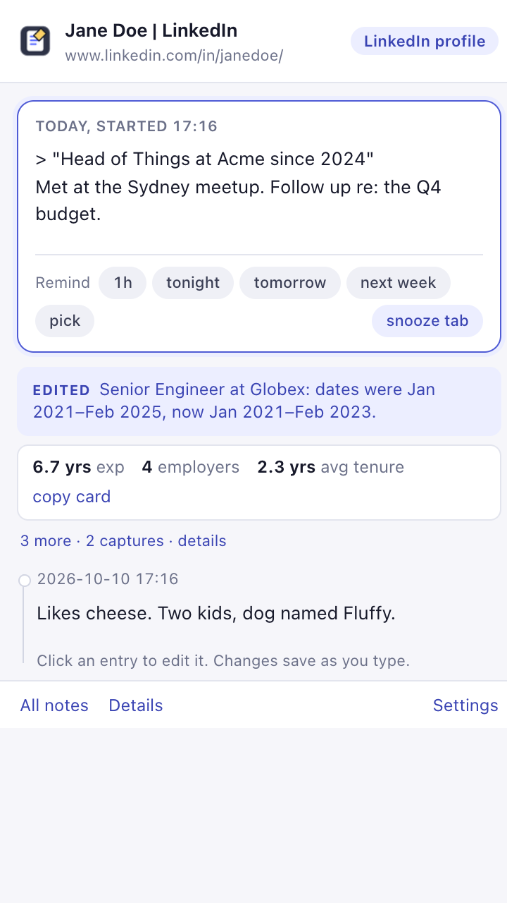
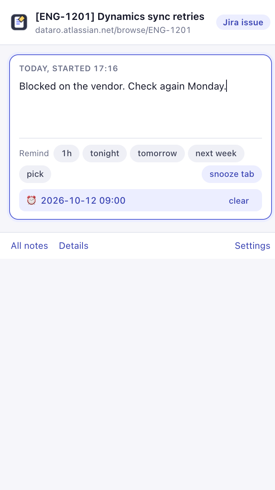
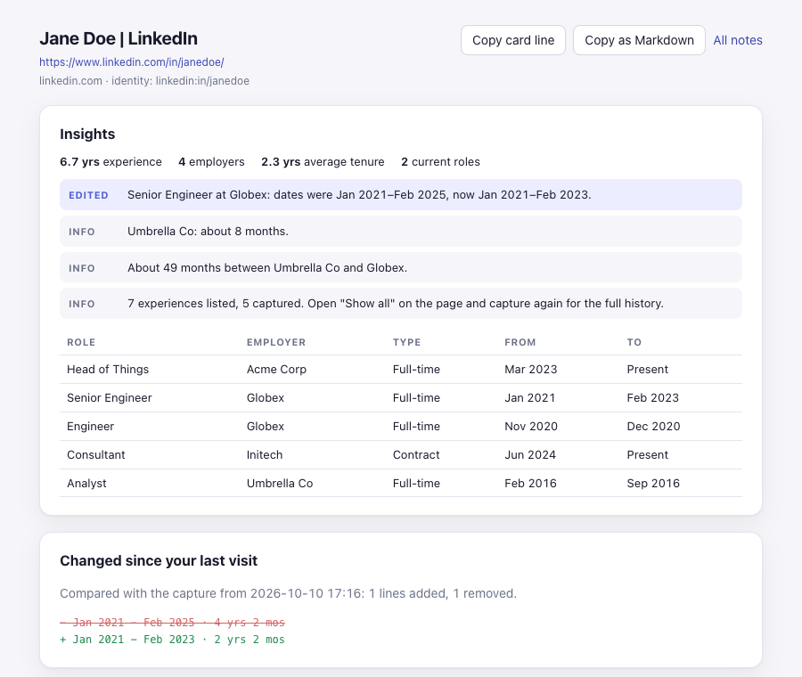
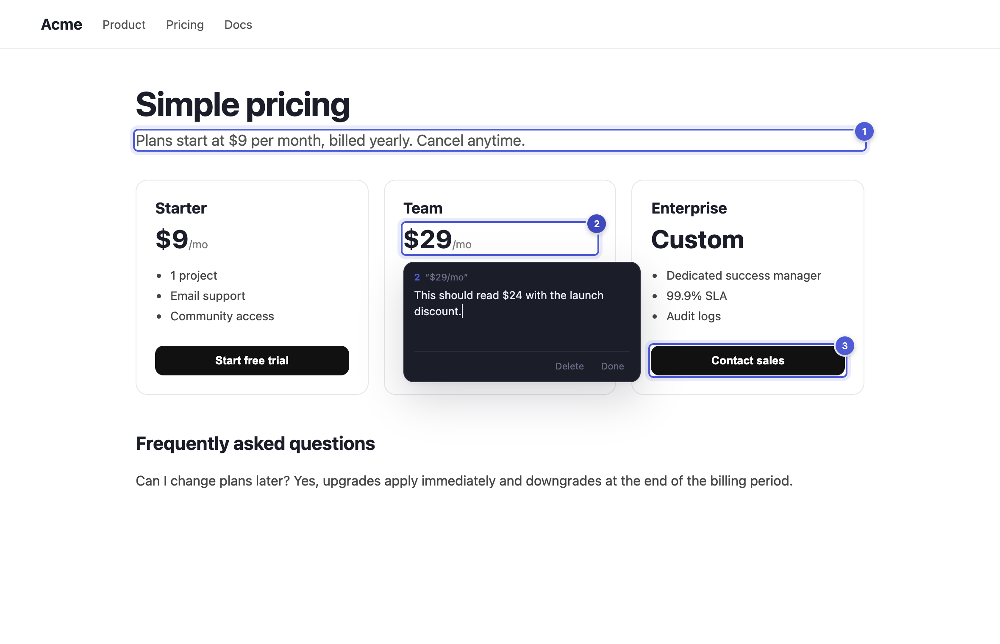

# Marginalia (Page Notes)

Notes in the margins of the web. A note on any page follows that page across URL variants, with dated entries, reminders, snoozed tabs, page snapshots, and Markdown export that Obsidian reads natively.

Vanilla JavaScript, Manifest V3, no build step, no dependencies, no server. Nothing leaves your browser. Works in Chrome, Brave, Edge and other Chromium browsers (Chrome 121 or newer).

<p>
  
  
</p>
<p></p>
<p></p>

## What it does

- **One note per page, many dated entries.** Click the toolbar icon on any page and type. It saves as you type; there is no Save button. Each day you write becomes a dated entry, and earlier entries edit in place with a click. A red toolbar badge counts entries and stickies on the current page; the sidebar highlights saved notes when you return.
- **Browse your notebook.** All notes is a Sites → Pages → Notes explorer, with three columns on a wide screen and one level at a time in the sidebar. Across all sites, pages are listed by site. Navigation is a hierarchy: the back arrow beside the sidebar's page title goes up to that site's saved pages, the arrow in the library climbs one more level and disappears at the top, and a breadcrumb jumps to any ancestor. "Current page" in the footer returns to the page you are on. Preview dated entries, stickies and captures, then explicitly open a page when you need it.
- **Link pages across sites.** Connect any saved page to any other when it makes sense to you: your GitHub profile to your LinkedIn, a ticket to its pull request. "+ Link" opens a type-to-find picker over your saved pages; linked pages show on both sides with their site, open in a click, and are carried in the Markdown frontmatter by canonical key so export and import keep them. Nothing is linked for you.
- **Open it your way.** In Settings, choose what the toolbar icon does: a popup next to the icon, a docked sidebar that follows the active tab and closes with its ✕ or another click on the icon, or a floating button on the page itself. The floating button and the window it opens can both be dragged anywhere and remember where you left them; the window is the extension's own page in a frame, so the site around it can neither read nor restyle your notes.
- **Stickies on the page.** Pin warm paper-style comments to page elements. The on-page control and popup's Show/Hide all button toggle stickies across open tabs; visibility is remembered after a reload. Adding or jumping to a sticky shows them again. Quotes and comments can be copied as a numbered feedback list.
- **The note follows the page.** A pull request and its Files tab, a Jira issue and its board link, a LinkedIn profile and its Experience page, a Google Doc in edit and view mode: one note. Nineteen built-in identity rules, the same engine as [Organize Tabs](https://github.com/hacktoolkit/organize-tabs-chrome-extension), editable with a live tester.
- **Capture a quote.** Select text, right-click, "Add selection to this page's note".
- **Remind me.** One click under the editor: in an hour, tonight, tomorrow, next week, or pick a time. The page reopens with a notification.
- **Snooze a tab.** One click: close it now, get it back tomorrow morning. Also a keyboard shortcut and a right-click item.
- **Captures.** Every time you open the popup on a page, what the page looked like is kept locally: title, core metadata (canonical URL, site, author, published date, JSON-LD types) and the page text. Identical captures collapse into one. So you have a local history of what you actually saw, and the note still makes sense if the page changes or vanishes.
- **Changed since your last visit.** When a page differs from its previous capture, the popup says so and the note's detail page shows the added and removed lines.
- **Profile insights.** On a LinkedIn profile the capture is parsed into a work history, and the extension points out what a careful reader would ask about: two full-time roles that overlap, two current full-time roles, dates that run backwards, short stints, long gaps. It also summarises years of experience, employers and average tenure, and builds a one-line card grouped by employer with promotions in order, ready to copy. Edits to the history between visits, such as an end date that moved, are called out separately. These are prompts for a conversation, never verdicts.
- **Markdown export.** Every note is a `.md` file with YAML frontmatter. Download them all as a zip, which also carries every capture as plain text under `captures/`, or import notes back.
- **A vault folder shared between browsers.** Connect a folder, in your Obsidian vault or in a synced drive such as iCloud Drive, and your notes live there as Markdown files: every save is written at once, and changes from other profiles are picked up as they land: while the sidebar, the floating widget or Settings is open, the folder is watched and only the changed files are read, with a check every five minutes as the safety net. Connect the same folder from each profile and they share one notebook; deletions follow too. The scan reads only file metadata and parses a file only when its content changed, so it stays quick with hundreds of notes, and there is no database to corrupt: the files are plain Markdown any app can read. The folder connection uses the File System Access API, which Chrome and Edge have on by default; Brave turns it off, and the settings page shows the flag to enable it. The browser asks once per session to re-allow access, and the popup offers the click.
- **Send stickies to someone.** "Share…" on a page turns your stickies, and your notes if you tick the box, into a small text file: JSON, deflate-compressed, base64, wrapped between `-----BEGIN MARGINALIA-----` and `-----END MARGINALIA-----` so it survives email and chat. Add a passphrase and it is encrypted with AES-256-GCM (key from PBKDF2-SHA256); without one it is readable by anyone with the extension. The recipient pastes it into "Import…" or drops the file into Settings, and the stickies land on their note for that page under their own identity rules, merged by id so nothing is overwritten. No server, no account.
- **Search** across titles, URLs, tags, entries, sticky comments and their quoted text, and a type-to-find picker wherever you choose a page. Previously saved LinkedIn titles automatically lose leading unread-message counts; historical captures and note dates are preserved.

## The note format

```markdown
---
title: "Jane Doe | LinkedIn"
url: https://www.linkedin.com/in/janedoe/
key: linkedin:in/janedoe
rule: "LinkedIn profile"
created: 2026-10-11T03:02:00.000Z
updated: 2026-10-18T22:30:00.000Z
tags: [people, sales]
remind: 2026-11-01T09:00:00.000Z
excerpt: "Jane Doe - Head of Things at Acme"
app: marginalia
---

## 2026-10-19 09:30

Renamed profile to "Jane D." Still at Acme.

## 2026-10-11 14:02

Likes cheese. Two kids, dog named Fluffy.
```

`key` is the page's canonical identity from the rules, which is what makes the note follow the page. Entries are `##` headings with a local timestamp, newest first in the file. Hand-written files with the same shape import fine, and text before the first heading becomes an undated entry.

## Privacy

Everything is stored in your browser profile with `chrome.storage.local`. No network requests, no accounts, no analytics. The in-page layer (sticky pins, and the floating button in that launch mode) is injected only when you click the icon or add a sticky on that page; the one exception is a site where you turned on "Always show stickies", which asks the browser for permission on that site alone. A page is captured only when you act on it, saving a note or opening the popup there, using the `activeTab` grant that your click provides, and the capture never leaves the browser. There are no background content scripts and nothing runs on pages you merely visit. Export and the Obsidian vault connection write files only where you choose.

Profile insights are computed locally from the text you captured, phrased as questions, and never make inferences about protected characteristics. Overlapping dates have ordinary explanations; the point is to know what to ask.

## Development

```sh
make test      # unit tests: note model, Markdown round-trip, zip writer, URL rules
make e2e       # every feature in a real headless browser
make dev       # the holodeck: a throwaway profile with the extension loaded
make package   # zip for the Chrome Web Store
```

Browser testing never touches a real profile; see `AGENTS.md` for the holodeck. Loading unpacked into your real profile: `chrome://extensions`, Developer mode, **Load unpacked**, pick this folder.

### Layout

```
src/background.js      service worker: messages, presence badge, reminders, snooze, context menu, export/import
src/lib/notes.js       pure note model, captures and Markdown (tested)
src/lib/profile.js     pure profile parser, consistency analysis, edit detection, text diff (tested)
src/lib/url.js         URL identity rules, copied from Organize Tabs (tested)
src/lib/anchor.js      how a sticky finds its element again: css, quote, path (tested)
src/content/           the in-page layer: pins, popover, pick mode, in a shadow root
src/lib/store.js       chrome.storage.local notes and index; Obsidian vault handle
src/lib/zip.js         minimal zip writer for export (tested)
src/lib/settings.js    settings in storage.sync with local fallback
src/popup.*            the note for the current page
src/options.*          all notes, reminders, backup and vault, settings, help
src/note.*             one note in full: insights, changes, entries, captures
src/lib/ui.js          shared DOM and messaging helpers for the three pages
src/lib/explorer.js    shared saved-page explorer for All notes and the sidebar
src/explorer.css       responsive columns and accordion layout
scripts/screenshots.mjs README images and 1280x800 store screenshots (make screenshots)
STORE_LISTING.md       Chrome Web Store copy, permission justifications, privacy answers
scripts/e2e.mjs        headless browser suite
scripts/dev.mjs        holodeck launcher
```

## History

This repository began in 2021 as "URL Notes", a Next.js app in a Manifest V2 shell. Version 1.0 is a rewrite on the Hacktoolkit extension skeleton.

## License

MIT. See LICENSE.md.
